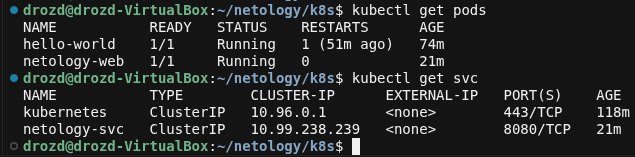
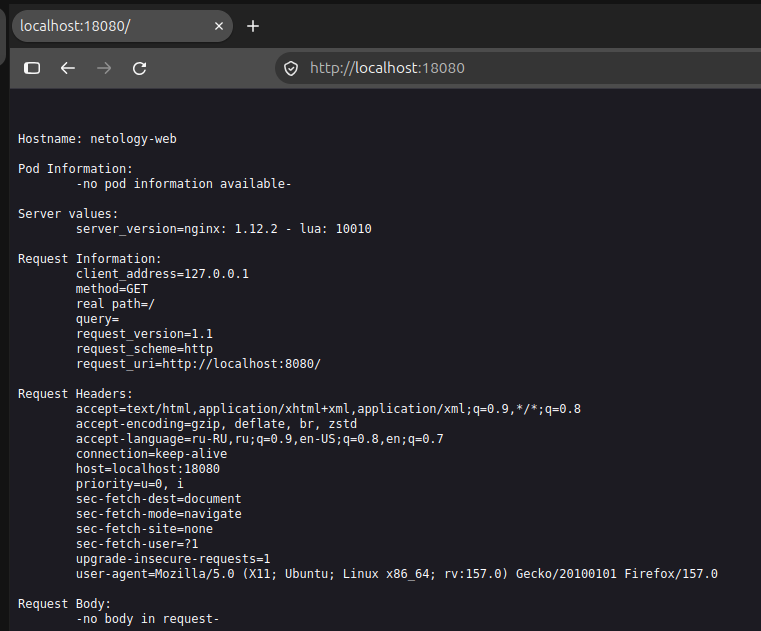

# Домашнее задание: Pod и Service в Kubernetes

## Содержание

- [Задание 1. Pod `hello-world`](#задание-1-pod-hello-world)
- [Задание 2. Pod `netology-web` и Service `netology-svc`](#задание-2-pod-netology-web-и-service-netology-svc)

---

## Задание 1. Pod `hello-world`

### Манифест

Файл: [hello-world.yml](./hello-world.yml)

### Применение и проверка

```bash
kubectl apply -f hello-world.yml
kubectl port-forward pod/hello-world 18080:8080
```

В другом терминале или в браузере:

```bash
curl http://127.0.0.1:18080
```

### Скриншоты

**1. Результат подключения (curl / браузер)**


---

## Задание 2. Pod `netology-web` и Service `netology-svc`

### Манифесты

- Pod: [netology-web.yml](./netology-web.yml)
- Service: [netology-svc.yml](./netology-svc.yml)

### Применение и проверка

```bash
kubectl apply -f netology-web.yml
kubectl apply -f netology-svc.yml
kubectl get pods
kubectl get svc
kubectl port-forward svc/netology-svc 18080:8080
```

В другом терминале:

```bash
curl http://127.0.0.1:18080
```

### Скриншоты

**1. Вывод `kubectl get pods`**




**3. Результат подключения к Service (curl / браузер)**


