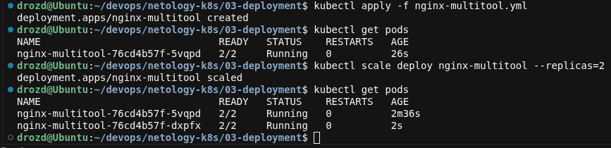
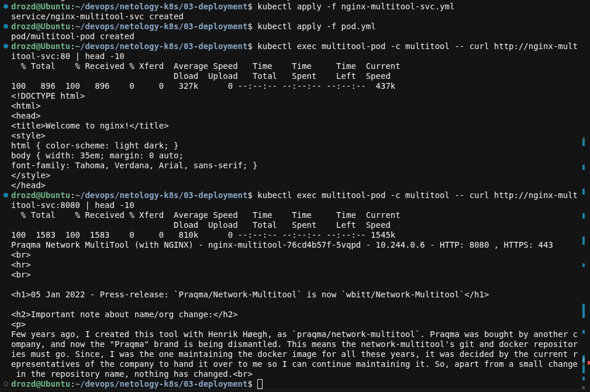
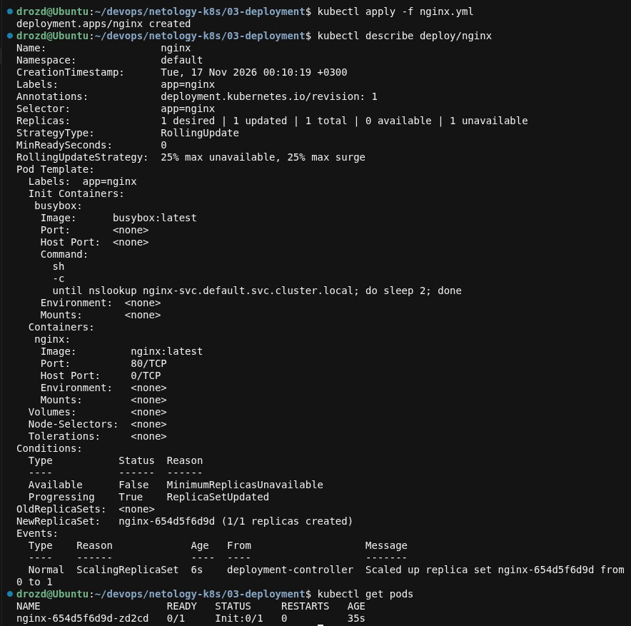
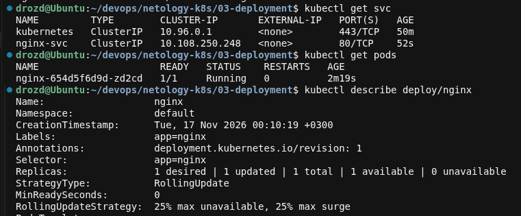

# Домашнее задание: Запуск приложений в K8S

Задание: [1.3.md](https://github.com/netology-code/kuber-homeworks/blob/main/1.3/1.3.md)

## Содержание

- [Задание 1. Deployment nginx + multitool, масштабирование и Service](#задание-1-deployment-nginx--multitool-масштабирование-и-service)
- [Задание 2. Deployment nginx с Init-контейнером](#задание-2-deployment-nginx-с-init-контейнером)

---

## Задание 1. Deployment nginx + multitool, масштабирование и Service

### Манифесты

- Deployment: [nginx-multitool.yml](./nginx-multitool.yml)
- Service: [nginx-multitool-svc.yml](./nginx-multitool-svc.yml)
- Pod для проверки: [pod.yml](./pod.yml)

Deployment состоит из двух контейнеров:

- `nginx` — порт `80`
- `multitool` (`praqma/network-multitool`) — порт `8080` (через `HTTP_PORT`)

### Применение и масштабирование

```bash
kubectl apply -f nginx-multitool.yml
kubectl get pods
kubectl scale deploy nginx-multitool --replicas=2
kubectl get pods
```

### Скриншот: до и после масштабирования



### Создание Service и проверка доступа из другого Pod

```bash
kubectl apply -f nginx-multitool-svc.yml
kubectl apply -f pod.yml

kubectl exec multitool-pod -c multitool -- curl http://nginx-multitool-svc:80 | head -n 10
kubectl exec multitool-pod -c multitool -- curl http://nginx-multitool-svc:8080 | head -n 10
```

### Скриншот: curl к портам 80 и 8080 через Service



---

## Задание 2. Deployment nginx с Init-контейнером

### Манифесты

- Deployment: [nginx.yml](./nginx.yml)
- Service: [nginx-svc.yml](./nginx-svc.yml)

Init-контейнер `busybox` ждёт появления Service в DNS:

```bash
until nslookup nginx-svc.default.svc.cluster.local; do sleep 2; done
```

Пока Service не создан, init не завершается — основной контейнер `nginx` не стартует.

### Применение Deployment (без Service)

```bash
kubectl apply -f nginx.yml
kubectl describe deploy/nginx
kubectl get pods
```

### Скриншот: nginx не стартует (Init:0/1)



### Создание Service и проверка старта

```bash
kubectl apply -f nginx-svc.yml
kubectl get svc
kubectl get pods
kubectl describe deploy/nginx
```

После появления Service init завершается, nginx переходит в `Running`.

### Скриншот: после запуска Service


