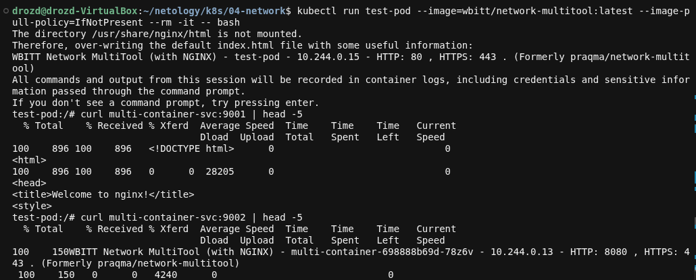
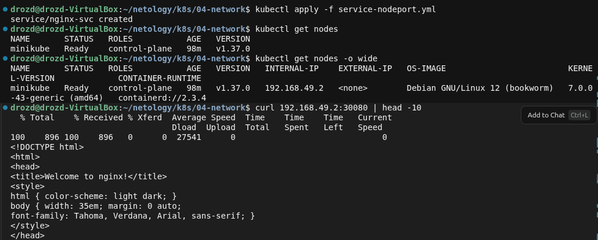
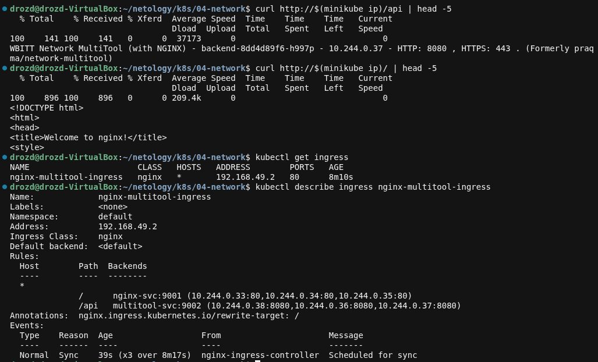

# Домашнее задание: Сетевое взаимодействие в Kubernetes

## Содержание

- [Задание 1. Service (ClusterIP и NodePort)](#задание-1-service-clusterip-и-nodeport)
- [Задание 2. Ingress](#задание-2-ingress)

---

## Задание 1. Service (ClusterIP и NodePort)

### Манифесты

- Deployment (nginx + multitool, 3 реплики): [deployment-multi-container.yml](./deployment-multi-container.yml)
- Service ClusterIP (nginx `:9001`, multitool `:9002`): [service-clusterip.yml](./service-clusterip.yml)
- Service NodePort (доступ к nginx снаружи): [service-nodeport.yml](./service-nodeport.yml)

### Применение

```bash
kubectl apply -f deployment-multi-container.yml
kubectl apply -f service-clusterip.yml
kubectl apply -f service-nodeport.yml
```

### Проверка ClusterIP (изнутри кластера)

```bash
kubectl run test-pod --image=wbitt/network-multitool --rm -it --image-pull-policy=IfNotPresent -- sh
curl <service-name>:9001   # nginx
curl <service-name>:9002   # multitool
```

### Проверка NodePort (с хоста)

```bash
curl $(minikube ip):<node-port>
```

### Скриншоты

**ClusterIP — доступ из тестового пода**



**NodePort — доступ с локальной машины**



---

## Задание 2. Ingress

### Манифесты

- Deployment frontend (nginx): [deployment-frontend.yml](./deployment-frontend.yml)
- Deployment backend (multitool): [deployment-backend.yml](./deployment-backend.yml)
- Service frontend: [service-frontend.yml](./service-frontend.yml)
- Service backend: [service-backend.yml](./service-backend.yml)
- Ingress (`/` → frontend, `/api` → backend): [ingress.yml](./ingress.yml)

### Применение

```bash
# Ingress-контроллер (minikube)
minikube addons enable ingress

kubectl apply -f deployment-frontend.yml
kubectl apply -f deployment-backend.yml
kubectl apply -f service-frontend.yml
kubectl apply -f service-backend.yml
kubectl apply -f ingress.yml
```

### Проверка

```bash
curl http://$(minikube ip)/
curl http://$(minikube ip)/api
```

### Скриншоты

**Ingress — доступ по `/` и `/api`**



